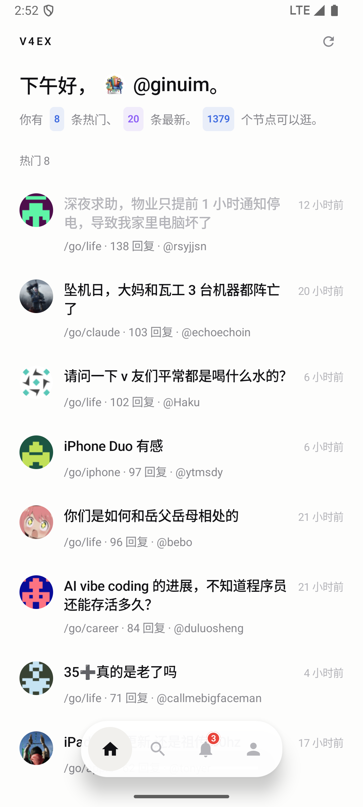
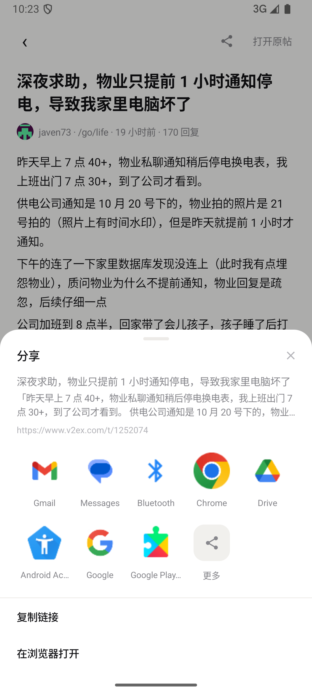
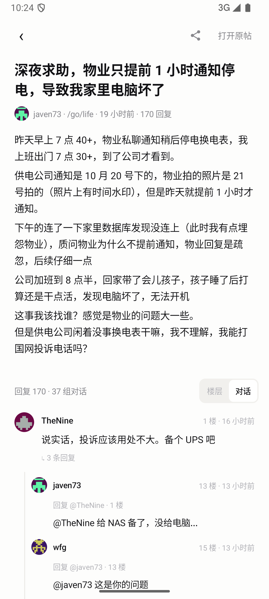

# V4EX

一个只读的 V2EX 客户端。Kotlin + Jetpack Compose，无第三方 UI 库，浅色「无卡片」排版。

不做 AI 摘要、不做内容过滤——**帖子原样呈现**，水贴、跑题、抬杠都留着。



## 功能

| 页面 | 内容 |
|---|---|
| 首页 | 问候语（内联头像 + 用户名）、数据概览、**热门 / 最新**两段列表；下拉刷新、上滑自动加载更多、已读主题标题置灰、**只看未读**开关、**本地缓存秒开** |
| 节点 | 1379 个节点，本地搜索（名称 / 标题），点进节点看主题列表 |
| 通知 | 未读提醒（回复 / 提及），底部标签带红色角标 |
| 我的 | 头像、会员 id、令牌有效期、注册时间；填写 / 更换 / 清空令牌；浏览历史入口 |
| 帖子 | 标题 + 正文 + 全部回复；**楼层 / 对话** 两种回复视图；右上角分享（分享到本机 App / 复制链接 / 浏览器打开） |

## 刷新 / 翻页 / 已读

| 能力 | 实现 |
|---|---|
| 下拉刷新 | Material3 `PullToRefreshBox`，刷新时保留列表（`refreshing` 与 `loading` 分开，不闪白） |
| 上滑加载更多 | 首页和节点主题页都是 `LazyColumn` + 距底部 4 项触发；数据走 v2 `/api/v2/topics/latest?p=N`、`/api/v2/nodes/:name/topics?p=N`（20 条/页） |
| 已读标记 | 打开主题即写入 DataStore（最多保留 800 条 id），列表里已读标题从 `#111114` 变 `#B4B4B9` |
| 只看未读 | 首页右上角开关，按 `readIds` 过滤，**只在渲染层过滤**不改原始数据，关掉立刻恢复；偏好存 DataStore，重启仍生效；过滤数量会在头部提示 |
| 首页缓存 | 打开 App 先读本地缓存渲染（列表字段，不存正文，约十几 KB），再后台**静默**拉新数据覆盖；`refreshing`（下拉指示器）与 `updating`（静默同步）分开，启动时不会突然弹转圈；拉取失败保留旧缓存 |

v1 的 `topics/latest.json` 没有翻页（`p` 参数被忽略），所以**没有令牌时只能刷到第一页**，底部会提示「填写令牌后可继续翻页」。填了令牌就是无限流。

## 分享



| 能力 | 实现 |
|---|---|
| 分享到本机 App | `PackageManager.queryIntentActivities(ACTION_SEND + text/plain)` 列出设备上真正能接分享的 App，按包名去重；微信 / QQ / 微博 / 钉钉 / 飞书 / Telegram / 小红书… 这些常见 App 固定排前面，其余按应用名排，最多 14 个；末尾「更多」走系统分享面板 |
| 复制链接 | `ClipboardManager` 只写纯链接，面板内「已复制链接 ✓」1.6s，**不关面板**，方便接着点某个 App；不弹 Toast，避免和 Android 13+ 系统自带剪贴板预览叠在一起 |
| 楼层分享 | 长按任意回复分享该楼：面板预览区显示该楼摘录，链接锚到 `#reply{floor}`，摘录同时写进分享正文（Markdown 清洗、压成一行、90 字截断）。帖子分享则带标题 + 正文摘录 |
| 包可见性 | Android 11+ 必须在 manifest 声明 `<queries>` 才能查到别的 App；不写的话网格永远是空的 |

## 按对话看回复



V2EX 的回复接口（v1 / v2）都**没有 parent 字段**，所以「谁在回复谁」只能从正文推断：

| 依据 | 规则 |
|---|---|
| 楼层引用优先 | 正文里的 `#12`、`#12 楼`、`12 楼`，目标必须存在且比当前楼层更早 |
| `@某人` 次之 | 取正文里第一个「已经发过言」的用户，挂到该用户最近的一条更早回复 |
| 都不匹配 | 留在顶层。**宁可少连，不要乱连**：解析不出、前向引用、目标楼层已删 → 一律顶层，绝不丢回复 |
| 渲染 | 子回复缩进一级 + 1.5dp 竖线（对齐父楼头像中线）+ 「回复 @x · N 楼」；祖孙再深也压到同一级（手机屏宽有限）；根回复下显示「↳ N 条回复」，N 是整组后代总数，和实际排出来的行数对得上 |
| 切换 | 「楼层 / 对话」只换顺序，回复条数不变、item key 不变，滚动位置不跳；选择存 DataStore，下次打开还是上次的视图 |

## 导航层级

页面栈是 `首页/节点列表 → 节点主题列表 → 帖子 → 个人页`。返回键的实现必须**和显示顺序相反**逐层退，
否则会出现「从节点点开帖子，返回时直接掉回首页」——节点栈被提前清掉了。

```kotlin
// MainActivity.BackHandler
openMember != null -> openMember = null   // 个人页叠在帖子之上
openHistory  -> openHistory = false
openTopic    -> openTopic = null          // 帖子 → 回到它来自的节点列表
openNode     -> openNode = null
```

## 登录

V2EX 没有 OAuth，只有 Personal Access Token：

1. 网页版 <https://www.v2ex.com/settings/token> 创建令牌（最长 360 天）
2. App 里「我的 → 填写令牌」粘贴

令牌用 DataStore 存在本机，不上传任何地方。**不填也能用**（首页/节点/帖子全部是 v1 免令牌接口）。

## 构建 / 安装

```bash
./gradlew assembleDebug
adb install -r app/build/outputs/apk/debug/app-debug.apk
# 或者直接：
./gradlew installDebug
```

要求：JDK 17+、Android SDK 35（compileSdk 35 / minSdk 26）。

release 包需要签名。在仓库根目录放一份 `keystore.properties`（**已在 .gitignore 里，不会被提交**）：

```properties
storeFile=keystore/release.jks
storePassword=***
keyAlias=***
keyPassword=***
```

没有这个文件时 `release` 构建会跳过签名，`debug` 包不受影响——直接 `assembleDebug` 就能用。

纯函数单测（分享文案 / 对话归组，不需要模拟器）：

```bash
./gradlew testDebugUnitTest
```

## 结构

```
app/src/main/java/com/v4ex/android/
├── MainActivity.kt           # 导航（4 个 tab + 详情页）、令牌弹窗
├── data/
│   ├── Api.kt                # OkHttp + org.json，v1 免令牌 / v2 带 token
│   ├── Conversation.kt       # 回复 → 对话树（#楼层 / @提及 推断 parent）
│   ├── Models.kt             # Topic / Reply / VNode / Me / Notice
│   ├── Prefs.kt              # DataStore 存令牌 / 已读 / 历史 / 视图偏好
│   └── SharePayload.kt       # 分享文案：标题 + 摘录 + 链接
└── ui/
    ├── AppViewModel.kt       # 全部状态（StateFlow），无 DI
    ├── components.kt         # Avatar / 话题行 / 行内胶囊 / 悬浮底栏
    ├── ReplyList.kt          # 楼层列表：平铺 / 对话两种顺序 + 长按分享
    ├── ShareSheet.kt         # 底部分享面板：App 网格 + 复制链接
    ├── theme/Theme.kt        # 唯一的颜色和字体来源
    └── screens/              # Home / Nodes / Notices / Me / Topic
app/src/test/java/com/v4ex/android/data/
├── ConversationTest.kt       # 归组规则（楼层 / @ / 前向引用 / 长链）
└── SharePayloadTest.kt       # 分享文案清洗与截断
```

## 已踩过的坑（踩之前不知道）

| 坑 | 处理 |
|---|---|
| `/api/topics/latest.json` 的 `p` 参数无效（p=1 与 p=2 返回同一批） | 首页只展示一页最新，翻页交给「节点」 |
| 主题和楼层是两个接口，串行要等 4s | 先渲染标题正文，回复到了再补；`loadTopic` 分两段更新状态 |
| Compose 里 `ActionRow("文字") { ... }` 尾随 lambda 会落到最后一个 Boolean 参数上 | 显式写 `onClick =` |
| 悬浮底栏会盖住列表最后一行 | 列表底部预留 110dp |
| 未登录时问候语出现「[占位头像] v 友」很怪 | 未登录不显示内联头像 |
| **底部角标被裁成水滴形** | 角标放在 `clip(CircleShape)` 的父容器里，被圆角裁掉了。改成父容器不裁、只裁背景层，角标用白描边 + 最小 16dp，压在铃铛右上角 |
| token 异步读盘，首帧误判「没令牌」→ 翻页被禁 | `init` 里 `_token.filterNotNull().first()` 之后再拉首页 |
| **分享面板点 App 崩**：`requires FLAG_ACTIVITY_NEW_TASK` | `ModalBottomSheet` 内容跑在 Dialog 窗口里，`LocalContext` 是 `ContextThemeWrapper` 而不是 Activity；沿 `ContextWrapper` 链找宿主 Activity，找不到才补 `FLAG_ACTIVITY_NEW_TASK` |
| Android 11+ 分享目标一个都查不到 | manifest 没写 `<queries>`，包可见性把别的 App 全挡住；声明 `ACTION_SEND + text/plain` 之后才看得到微信 / Gmail 等 |
| 长按楼层里 `detectTapGestures` 收不到手势 | 头像 / 用户名 / 正文自己的 `clickable` 在 Main pass 先吃掉了 down；改成 Initial pass 自己计时判长按，命中后消费剩余事件（松手时内层点击自动取消） |
| 回复没有 parent 字段，`@` 与 `#楼层` 会「打架」 | 楼层引用优先于 @；只认更早且存在的楼层。比如「@javen73 #10」会挂到 10 楼而不是 javen73 的最新发言 |
| 切对话视图列表跳动 | 两种模式回复条数不变，item key 固定 `reply-{id}`，只换顺序；不要按模式改 key，否则 LazyColumn 会整段重建 |
| 分享网格里「Gmail 图标 + Chat 文案」 | `queryIntentActivities` 回来的 Activity label 不可靠（Gmail 的分享 Activity 自己叫 Chat）；改用 `getApplicationLabel` 读应用名 |
| 复制链接的 Toast 被系统剪贴板预览盖住 | Android 13+ 复制时会自己弹预览浮层；去掉自己的 Toast，只留面板内「已复制链接 ✓」 |

## 刻意不做

- **发帖 / 回帖**：V2EX 的 v2 写接口只对 PRO 会员开放，普通账号一律 403。要做只能塞 WebView，不值得。
- **感谢 / 收藏 / 私信**：API 根本没有这些端点。
- **AI 摘要 / 内容过滤**：试过，去掉了。筛完的「要点」读起来像被嚼过的饭——V2EX 的意思一半在楼层的语气、跑题和互怼里，滤掉就没了。只做纯粹的客户端。
- **无限层级盖楼**：移动端一级缩进已经够表达「在回谁」，再深只是把正文挤窄，所以祖孙统一压到第二级。
- **账号密码登录**：只支持 PAT。V2EX 没有 OAuth，密码不该经过第三方 App。
